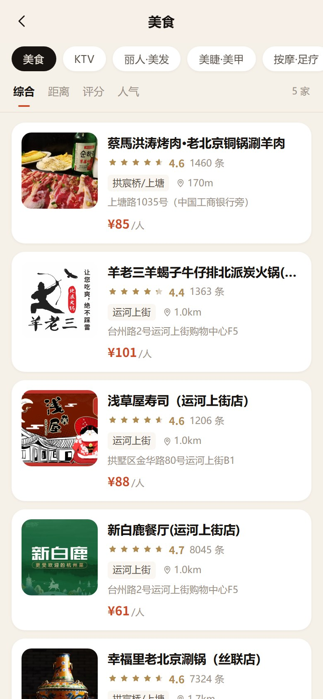
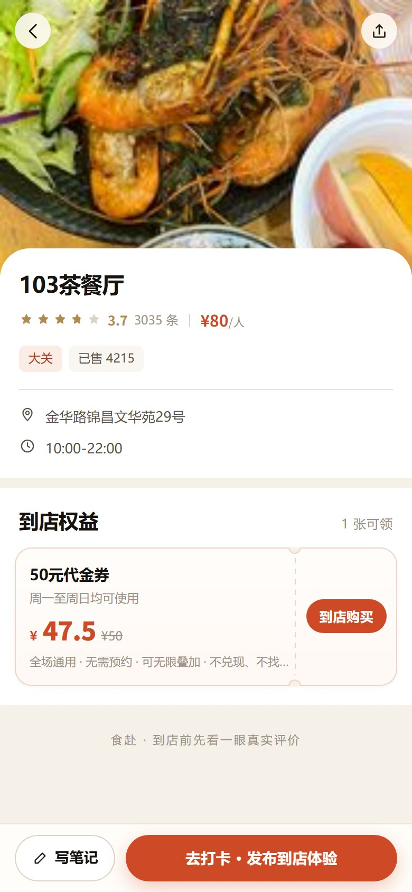
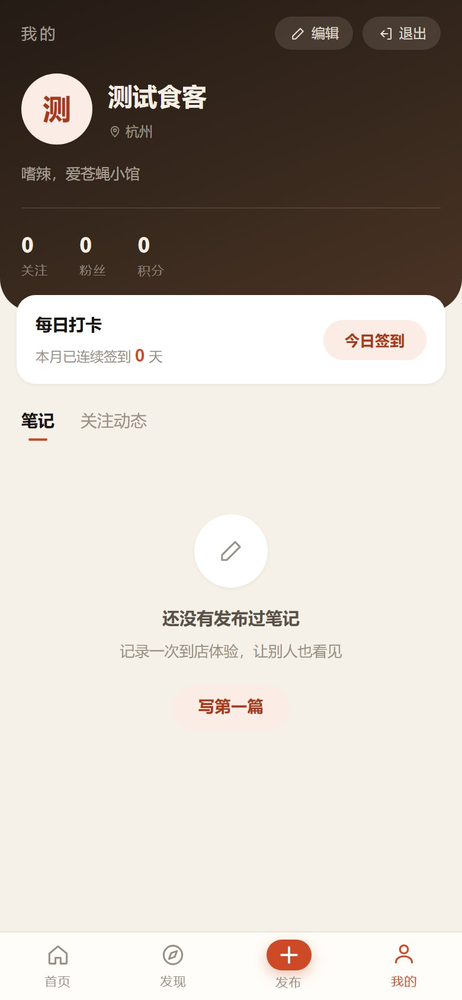
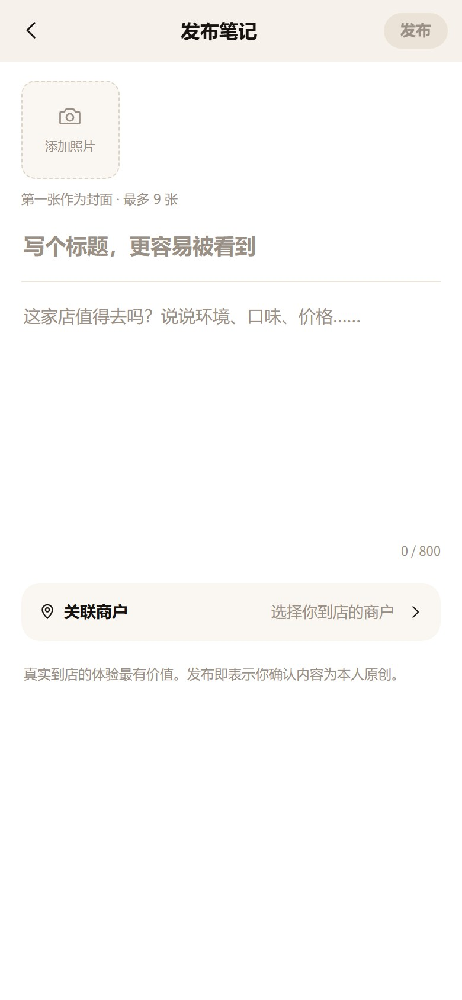
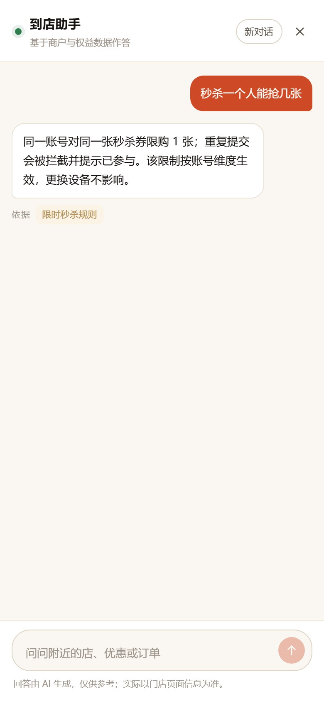
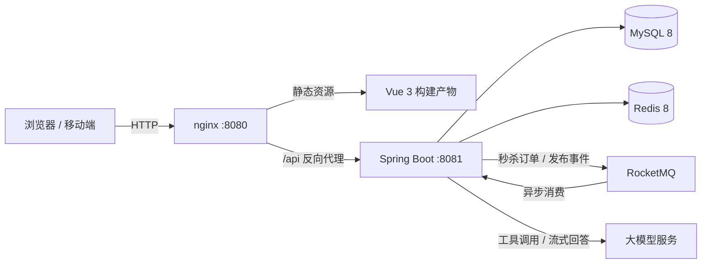

<div align="center">

# 食赴 ShiFu

面向「到店」场景的本地生活社区 · 商户发现 / 权益卡秒杀 / 实拍笔记 / 关注流


</div>

## 项目简介

食赴是一个前后端分离的本地生活社区应用。用户按分类浏览周边商户、领取到店权益卡，发布带图的到店体验笔记，并通过关注关系形成个性化信息流。

与常见的单体示例应用不同，本项目在业务功能之上完整实现了缓存一致性、高并发下单、异步消息与前后端工程化等生产环境关注点：秒杀链路采用 Redis + Lua 原子扣减并交由 RocketMQ 异步落库；关注流采用异步扇出配合 pipeline 批量写入；前端为独立工程，具备设计系统、路由分包与统一请求层。

应用另内置到店助手：基于 Spring AI 接入大模型，通过工具调用读取商户、权益卡与订单数据作答，回答可追溯到具体记录，模型不可用时自动回退为规则应答。

## 功能

| 模块 | 能力 |
| --- | --- |
| 商户 | 分类浏览、按距离 / 评分 / 人气排序、关键字搜索、详情与图集 |
| 笔记 | 热门瀑布流、图文发布（多图上传）、标题建议与异步补写、点赞、关注作者、关注流 |
| 权益卡 | 商户权益列表、限时秒杀、库存与时间窗校验 |
| 账户 | 手机验证码登录、资料编辑、每日签到、他人主页与共同关注 |
| 到店助手 | 流式问答、工具调用查询商户与权益、规则库检索与来源标注、已购券查询、引用跳转、限流与降级 |
| 基础能力 | 分布式 ID、登录态管理、全局异常处理、统一响应结构 |

## 界面预览

| 首页 | 商户列表 | 商户详情 |
| :---: | :---: | :---: |
|  |  |  |

| 笔记详情 | 个人主页 | 发布笔记 |
| :---: | :---: | :---: |
|  |  |  |

| 到店助手 |
| :---: |
|  |

## 系统架构



职责划分：

- **nginx** 托管前端构建产物并反向代理 `/api`，同时承载用户上传的图片
- **应用层** 采用 Controller → Service → Mapper 三层结构，横向切面处理登录态、异常与统一响应
- **Redis** 承担缓存、秒杀库存预扣、商户地理索引、点赞集合、关注流收件箱、会话令牌与助手会话记忆
- **RocketMQ** 承担秒杀订单落库与笔记发布扇出两条异步链路
- **大模型服务** 承担到店助手的意图理解与表达，事实数据一律由服务端工具提供

## 技术栈

| 分类 | 选型 |
| --- | --- |
| 运行时 | JDK 17、Spring Boot 3.5.16 |
| 持久层 | MyBatis-Plus 3.5、MySQL 8.0 |
| 缓存与中间件 | Redis 8、Redisson、RocketMQ 5.3.4 |
| 智能问答 | Spring AI 1.1、DeepSeek（OpenAI 兼容接口） |
| 前端 | Vue 3、Vite 6、Vue Router 4、Pinia、Axios |
| 静态托管 | nginx |

## 核心实现

### 秒杀下单

请求先经 Java 层校验权益卡类型与时间窗，再执行 Lua 脚本完成「库存校验 + 一人一单 + 扣减 + 下单标记」的原子操作，判定通过后投递 RocketMQ 异步落库。消息投递失败时回滚 Redis 库存与下单标记，避免出现扣减库存却无订单的中间态；消费端以用户维度加分布式锁并复查订单，保证消息重投下的幂等。

### 关注流扇出

发布笔记后不在请求线程遍历粉丝写入收件箱，而是投递发布事件，由消费端查询粉丝列表并按每批 500 条通过 pipeline 写入各用户的 `feed:{userId}` 有序集合，使接口耗时与粉丝规模解耦。消息中间件不可用时自动降级为同步推送，功能不受影响。

### 商户地理检索

商户坐标在应用启动时幂等写入 Redis GEO 索引，按类型分页检索时执行 `GEOSEARCH` 并按距离排序；索引缺失或半径内无命中时回退数据库查询，避免列表空白。

### 缓存与一致性

商户详情、商户类型、笔记详情采用 Cache Aside 策略，热点数据设置逻辑过期以规避缓存击穿；点赞与关注关系使用集合结构支撑幂等操作。

### 到店助手

助手通过工具调用获取事实，而不是把业务数据拼进上下文：模型负责理解意图与组织表达，商户、权益卡、已购券一律由只读工具查询，回答可追溯到具体记录。

- **工具只读**：不暴露下单、秒杀、退款等写操作，交易仍由原页面链路完成，库存原子性与订单幂等不被绕过
- **规则类问答走检索**：退款、用券、秒杀、笔记规范等政策维护为 Markdown 文档，按小节切片后用中文单字 + 二元组的 TF-IDF 检索，回答标注来源文档
- **身份不可伪造**：涉及个人数据的方法不接受用户 id 参数，由服务端在请求线程取得登录用户后注入。工具运行在模型回调线程，登录上下文不可用，因此身份在工具实例构造时固化
- **流式输出**：SSE 逐段下发；模型按 token 返回时中文常单字成段，服务端合并后推送以减少帧数
- **会话记忆**：Redis List 保存最近 20 条消息并设置两小时过期，工具调用的中间过程不进入记忆
- **成本与稳定**：按用户 / IP 滑动窗口限流，逐次记录 token 用量；模型不可用时回退为关键字规则应答，客服入口不会白屏

### 笔记标题生成

发布页提供「帮我想」按钮，根据正文生成三个标题候选点选填入；接口层另有兜底：标题为空时投递事件，由消费端生成后回写。

- **不阻塞发布**：生成走 RocketMQ，模型响应时间不进请求链路，MQ 不可用时放弃补写，笔记仍按空标题发布
- **独立客户端**：标题生成不需要会话记忆，单独构建 ChatClient，避免复用客服客户端时因缺少 conversationId 报错
- **幂等回写**：更新语句带「标题仍为空」条件，用户同时手动填写时不会被覆盖
- **成本控制**：单用户每天 30 次，输出限 26 字并做格式清洗（去编号、引号与解释性前缀）

## 快速开始

### 环境要求

| 依赖 | 版本 | 端口 |
| --- | --- | --- |
| JDK | 17+ | - |
| MySQL | 8.0 | 3306 |
| Redis | 7+ | 6379 |
| RocketMQ | 5.x（可选） | 9876 / 10911 |
| Node.js | 18+ | - |

RocketMQ 未部署时应用仍可启动，秒杀与异步扇出功能自动降级。

### 1. 初始化数据库

```bash
mysql -uroot -p -e "CREATE DATABASE shifu DEFAULT CHARSET utf8mb4;"
mysql -uroot -p shifu < src/main/resources/db/shifu.sql
```

### 2. 启动后端

配置位于 `src/main/resources/application.yaml`，数据库与 Redis 口令默认从环境变量读取，未设置时使用本机开发默认值。

```bash
mvn clean package -DskipTests
java -jar target/shifu-server-1.0.0-SNAPSHOT.jar
```

服务默认监听 `8081`。

#### 配置模型密钥（可选）

到店助手需要一个大模型密钥。复制示例文件并填入真实值：

```bash
cp config/application-secret.yaml.example config/application-secret.yaml
```

也可以直接设置环境变量 `DEEPSEEK_API_KEY`，优先级高于配置文件。未配置时助手自动切换为规则应答模式，其余功能不受影响，应用仍可正常启动。

### 3. 启动前端

```bash
cd frontend
npm install
npm run dev        # 开发模式，/api 自动代理至 8081
```

生产构建与发布：

```bash
npm run build
npm run publish:nginx    # 构建产物写入 nginx 静态目录
```

nginx 需为前端 history 路由配置回退，详见 [frontend/README.md](frontend/README.md)。

## 项目结构

```
shifu-server/
├── src/main/java/com/shifu/
│   ├── controller/          REST 接口层
│   ├── service/             业务接口与实现
│   ├── mapper/              MyBatis-Plus Mapper
│   ├── entity/              数据表实体
│   ├── dto/                 统一响应、表单与分页对象
│   ├── config/              MVC 拦截器、Redisson、地理索引初始化
│   ├── agent/               到店助手：只读工具、规则检索、会话记忆、编排与接口
│   ├── mq/                  秒杀订单与发布事件的生产者 / 消费者
│   └── utils/               常量、登录上下文、分布式 ID、Lua 脚本支持
├── src/main/resources/
│   ├── application.yaml     应用配置
│   ├── db/shifu.sql         建表语句与初始数据
│   ├── mapper/              XML 映射
│   └── seckill.lua          秒杀原子脚本
├── frontend/                Vue 3 前端工程
├── perf/                    压测脚本与数据夹具
└── docs/                    部署文档与界面截图
```

## 接口一览

| 方法 | 路径 | 说明 |
| --- | --- | --- |
| `GET` | `/merchant-category/list` | 商户类型列表 |
| `GET` | `/merchant/of/type` | 按类型分页检索商户（支持坐标与排序） |
| `GET` | `/merchant/of/name` | 商户关键字搜索 |
| `GET` | `/merchant/{id}` | 商户详情 |
| `GET` | `/note/hot` | 热门笔记分页 |
| `GET` | `/note/{id}` | 笔记详情 |
| `POST` | `/note` | 发布笔记 |
| `PUT` | `/note/like/{id}` | 点赞 / 取消点赞 |
| `GET` | `/note/of/follow` | 关注流（滚动分页） |
| `GET` | `/benefit/list/{merchantId}` | 商户权益卡列表 |
| `POST` | `/benefit-order/seckill/{benefitId}` | 秒杀下单 |
| `POST` | `/user/code`、`/user/login` | 验证码与登录 |
| `GET` | `/user/me`、`/user/info/{id}` | 当前用户与资料 |
| `PUT` | `/user/info` | 更新个人资料 |
| `PUT` | `/follow/{id}/{isFollow}` | 关注 / 取关 |
| `POST` | `/assistant/chat` | 到店助手流式问答（SSE） |
| `GET` | `/assistant/config` | 助手可用状态 |
| `GET` | `/assistant/knowledge` | 规则库清单与检索诊断 |
| `POST` | `/assistant/note/title` | 根据正文生成标题候选 |

## 文档

- [RocketMQ 部署与接入](docs/RocketMQ部署与接入.md)：部署步骤、Topic 设计、降级策略
- [到店助手](docs/到店助手.md)：工具设计、身份传递、记忆与降级策略
- [秒杀压测报告](docs/压测报告.md)：测试模型、并发结果、瓶颈定位与调优对比
- [前端工程说明](frontend/README.md)：目录结构、页面与接口映射、构建发布

## License

[MIT](LICENSE)
